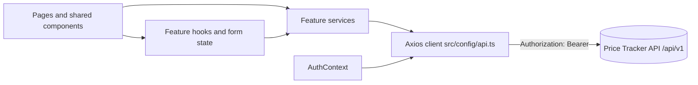

<div align="center">

# Price Tracker Web 🏷️

**React single-page frontend for the Price Tracker ecosystem: monitor product URLs, follow price history, and set target prices from one dashboard.**

[](https://react.dev/)
[](https://www.typescriptlang.org/)
[](https://vite.dev/)
[](https://tailwindcss.com/)
[](https://recharts.org/)
[](https://oxc.rs/)
[](LICENSE)

<br />

<p align="center">
  <a href="#overview"><b>Overview</b></a> •
  <a href="#stack"><b>Stack</b></a> •
  <a href="#architecture"><b>Architecture</b></a> •
  <a href="#quick-start"><b>Quick Start</b></a> •
  <a href="#configuration"><b>Configuration</b></a> •
  <a href="#features-and-routes"><b>Features</b></a> •
  <a href="#scripts"><b>Scripts</b></a> •
  <a href="#testing"><b>Testing</b></a> •
  <a href="#deployment"><b>Deployment</b></a> •
  <a href="#known-limitations-mvp-trade-offs"><b>Limitations</b></a> •
  <a href="#governance"><b>Governance</b></a>
</p>

</div>

---

> **Backend repository:** [felipevenas/api-price-tracker](https://github.com/felipevenas/api-price-tracker) ·
> **API consumed by this app:** Price Tracker API, versioned under `/api/v1`

## Overview

Price Tracker Web is the customer-facing interface of the Price Tracker ecosystem. A user registers or signs in, adds the URL of a product they want to follow, optionally defines a target price and a check interval, and then watches the collected price history in an interactive chart.

This repository owns the **browser application only**:

- Authentication screens, session bootstrap, and protected routing.
- The product dashboard with search, status filters, summary counters, and product creation.
- Product detail with price history, target-price configuration, pause/resume, and deletion.
- Light/dark theming, toast feedback, loading states, and responsive layouts.

It does **not** own scraping, scheduling, price collection, persistence, or authorization decisions. Those belong to the [Price Tracker API](https://github.com/felipevenas/api-price-tracker), which is the source of truth for every operation.

## Stack

Versions below were verified against `package-lock.json`. `package.json` declares compatible ranges, so a fresh install may resolve a newer patch or minor within those ranges.

| Package | Locked version | Role |
|---|---|---|
| React / React DOM | 19.2.8 | Component model and rendering |
| TypeScript | 6.0.3 | Static typing; project references via `tsc -b` |
| Vite | 8.1.5 | Development server and production bundler |
| React Router DOM | 7.18.1 | Client-side routing and route guards |
| Tailwind CSS | 4.3.3 | Utility-first styling through the Vite plugin |
| Recharts | 3.10.1 | Price-history line chart |
| Axios | 1.18.1 | HTTP client, bearer-token injection, `401` handling |
| React Hook Form | 7.83.0 | Form state |
| Zod | 4.4.3 | Client-side input validation |
| `@hookform/resolvers` | 5.5.7 | Zod resolver for React Hook Form |
| Lucide React | 1.27.0 | Icon set |
| React Hot Toast | 2.6.0 | Non-blocking toast notifications |
| Oxlint | 1.75.0 | Static analysis |

**Runtime:** Node.js LTS and npm. The project was validated locally with Node `24.11.0` and npm `11.6.1`; the repository does not declare an `engines` field, so no version is enforced at install time.

## Architecture

```text
webapp-price-tracker/
├── public/                     static assets served as-is (favicon, icon sprite)
├── src/
│   ├── assets/                 images imported by the bundle
│   ├── components/             shared UI primitives (Button, Card, Input, Modal, Spinner, ThemeToggle)
│   ├── config/                 Axios instance, base URL, request/response interceptors
│   ├── context/                AuthContext and ThemeContext
│   ├── features/
│   │   ├── auth/               constants, forms, pages, service, API types
│   │   └── products/           cards, chart, form, list, hooks, pages, service, API types
│   ├── hooks/                  reusable hooks (useDebounce)
│   ├── layouts/                AuthLayout and DashboardLayout
│   ├── routes/                 AppRoutes and PrivateRoute
│   ├── utils/                  currency, date, and text formatters
│   ├── App.tsx                 providers, router, and global toaster
│   ├── App.css                 small application-specific adjustments
│   ├── index.css               Tailwind import, theme tokens, and global styles
│   └── main.tsx                React entry point
├── index.html                  HTML shell
├── vite.config.ts              React and Tailwind plugins
├── tsconfig.json               project references
├── tsconfig.app.json           browser application compiler options
└── tsconfig.node.json          Vite config compiler options
```

The codebase is organized **by feature**, with a small shared layer:

| Layer | Location | Responsibility |
|---|---|---|
| Entry and providers | `src/main.tsx`, `src/App.tsx` | Mount React, install `BrowserRouter`, theme, auth, and toast providers |
| Routing | `src/routes/` | Declare public and private route trees; guard authenticated pages |
| Layouts | `src/layouts/` | Authentication shell and dashboard shell (header, user menu, footer) |
| Features | `src/features/<feature>/` | Pages, components, hooks, services, and API contracts for one domain |
| Shared UI | `src/components/` | Reusable presentational primitives with no domain rules |
| Infrastructure | `src/config/api.ts` | Single Axios instance, bearer token, and global `401` behavior |
| Global state | `src/context/` | Authentication session and light/dark theme |

### Request flow



1. A page calls a feature service such as `productService.getProducts()` or `authService.login()`.
2. The Axios instance reads the JWT from `localStorage` and adds `Authorization: Bearer <token>` to the request.
3. The API returns the `{ status, message, data }` envelope used by this client.
4. A `401` response removes the stored token and dispatches the `auth:session-expired` browser event.
5. Feature hooks update local React state and surface success or failure through `react-hot-toast`.

### Session handling

- The access token returned by `POST /auth/login` is persisted in `localStorage` under `webapp_price_tracker_token`.
- On boot, `AuthProvider` calls `GET /users/me` when a token exists and restores the user session.
- `PrivateRoute` redirects anonymous users to `/login`; `AuthLayout` redirects authenticated users to `/dashboard`.
- This client has **no refresh-token flow**. When the API rejects the token, the stored token is cleared and the user must sign in again.

### Styling and theming

- Tailwind CSS 4 is loaded through `@tailwindcss/vite`; there is no `tailwind.config` file.
- Theme tokens and global styles live in `src/index.css` and are consumed through CSS variables and utility classes.
- `ThemeContext` persists `light` or `dark` in `localStorage` under `theme` and falls back to `prefers-color-scheme`, defaulting to dark.

## Quick Start

### Prerequisites

- **Git**.
- **Node.js LTS** and **npm** (validated with Node `24.11.0` / npm `11.6.1`).
- The **Price Tracker API** running locally for any authenticated flow. Follow the backend repository instructions: [felipevenas/api-price-tracker](https://github.com/felipevenas/api-price-tracker).

### 1. Clone and install

```powershell
git clone https://github.com/felipevenas/webapp-price-tracker.git
cd webapp-price-tracker
npm install
```

Use `npm ci` when you need a reproducible install from `package-lock.json`.

### 2. Create the local environment file

```powershell
Copy-Item .env.example .env.local
```

The example already points to the default local API URL: `http://localhost:8000/api/v1`.

### 3. Start the API

Start the Price Tracker API on `http://localhost:8000` and make sure its CORS configuration accepts the frontend origin (`http://localhost:5173` by default). Database and API setup steps are documented in the [backend repository](https://github.com/felipevenas/api-price-tracker).

### 4. Start the frontend

```powershell
npm run dev
```

Open the URL printed by Vite, normally **http://localhost:5173**. If that port is busy, Vite selects the next available port; always use the URL shown in the terminal.

### 5. Sign in or register

Open `/register` to create an account, then `/login`. After authentication you are redirected to `/dashboard`.

## Configuration

Vite exposes **only** variables prefixed with `VITE_` to the browser. Every `VITE_*` value is embedded in the client bundle and must be treated as public. Never place API secrets, private keys, or credentials in this repository or in a `VITE_*` variable.

| Variable | Required | Default / example | Description |
|---|---|---|---|
| `VITE_API_BASE_URL` | No | `http://localhost:8000/api/v1` | Base URL used by the Axios client. Must include the API version prefix when the backend requires it. In production, use the public HTTPS API URL, for example `https://api.example.com/api/v1`. |

Notes:

- `src/config/api.ts` is the only module that reads `import.meta.env`. No other environment variable is currently consumed by the application.
- Vite inlines environment values at build time. Changing a value requires restarting the dev server or rebuilding the production bundle.
- `.env.local` matches the `*.local` rule in `.gitignore` and is the recommended file for machine-specific values.
- `.env.example` contains placeholder values only.

## Features and Routes

### Product capabilities

- **Authentication:** registration with name, e-mail, and password; login with e-mail and password; session restore through `/users/me`.
- **Dashboard:** summary counters (total, active, target met, missing price), debounced search by name or URL, and filters for all, active, target met, and paused products.
- **Product creation:** URL, display name, optional target price, and check interval validated between 1 and 1440 minutes.
- **Product detail:** current price, target price, check interval, monitoring status, last check, creation date, source hostname, price-history line chart, and inline editing.
- **Monitoring controls:** pause/resume and immediate refresh of product data and history.
- **Deletion:** remove a product directly from its dashboard card.
- **Theming and feedback:** light/dark mode persisted across sessions; toast notifications for the main mutations and failures.

### Routes

| Route | Access | Screen |
|---|---|---|
| `/` | Public | Redirects to `/dashboard` |
| `/login` | Anonymous only | Login form |
| `/register` | Anonymous only | Registration form |
| `/dashboard` | Authenticated | Product dashboard, search, filters, and creation modal |
| `/products/:id` | Authenticated | Product detail, price history, and alert configuration |
| `*` | Public | Fallback redirect to `/dashboard` |

Anonymous users who open a private route are redirected to `/login`. Authenticated users who open `/login` or `/register` are redirected to `/dashboard`.

### API endpoints used

All paths are relative to `VITE_API_BASE_URL`.

| Method | Endpoint | Purpose |
|---|---|---|
| `POST` | `/auth/register` | Create an account (`email`, `full_name`, `password`) |
| `POST` | `/auth/login` | Authenticate with `application/x-www-form-urlencoded` (`username`, `password`) |
| `GET` | `/users/me` | Restore the authenticated profile |
| `GET` | `/products/` | List products with `skip` and `limit` (defaults: `0`, `100`) |
| `POST` | `/products/` | Create a product |
| `GET` | `/products/{id}` | Load one product |
| `PUT` | `/products/{id}` | Update name, target price, interval, or active state |
| `DELETE` | `/products/{id}` | Delete a product |
| `GET` | `/products/{id}/history` | Load the price-history series |

## Scripts

| Command | Purpose |
|---|---|
| `npm run dev` | Start the Vite development server with hot module replacement |
| `npm run build` | Run `tsc -b` and produce the optimized bundle in `dist/` |
| `npm run lint` | Run Oxlint over the source tree |
| `npm run preview` | Serve the built `dist/` folder locally for a final check |

There is currently **no** `test`, `typecheck`, `format`, or `e2e` script. Type checking is part of `npm run build`, because the build starts with `tsc -b`.

## Testing

This repository has **no automated test suite at the moment**: there is no test runner in `package.json`, no test files under `src/`, and no CI workflow under `.github/workflows/`.

Available quality gates:

```powershell
npm run lint
npm run build
```

`npm run build` is also the type gate: TypeScript runs first and fails the build on type errors.

Current baseline: both commands exit successfully, but Oxlint reports five existing warnings (unused catch parameters, an `exhaustive-deps` warning, and two Fast Refresh warnings), and the production build reports a chunk larger than 500 kB. New changes should not add warnings.

Recommended manual smoke test before a pull request:

1. Register a new account and confirm the redirect to `/login`.
2. Sign in and confirm the redirect to `/dashboard`.
3. Create a product with a valid URL, a target price, and a check interval.
4. Search by name and by URL; exercise each dashboard filter.
5. Open the product detail, confirm the chart renders, edit the target price, pause and resume monitoring.
6. Delete the product and confirm the card disappears.
7. Toggle light/dark mode, reload the page, and confirm the preference persists.
8. Open a private route while signed out and confirm the redirect to `/login`.

Adding **Vitest** and **React Testing Library**, plus a CI workflow that runs lint, tests, and build, is the recommended next quality investment. No test infrastructure should be assumed until it is committed.

## Deployment

The production artifact is a static single-page application:

```powershell
npm run build
```

The output is written to `dist/`. Serve that directory from any static host or CDN and configure a **SPA fallback** so unknown paths return `index.html`; otherwise direct navigation to `/dashboard` or `/products/:id` returns a host-level `404`.

Operational checklist:

- Set `VITE_API_BASE_URL` to the public HTTPS API URL **before** building, then rebuild. The value is inlined at build time.
- Allow the deployed frontend origin in the API's CORS configuration.
- Serve the frontend over HTTPS and avoid calling an HTTP API from an HTTPS page (mixed content is blocked by browsers).
- Do not commit platform credentials. This repository does not include a `vercel.json`, `netlify.toml`, `Dockerfile`, or deployment workflow, so no specific hosting provider is prescribed.

`npm run preview` serves the local build for a final verification, but it is not a production server.

## Known Limitations (MVP Trade-offs)

These are conscious decisions in the current codebase, documented so contributors do not mistake them for finished behavior.

### Authentication and session

- **The access token is stored in `localStorage`.** Any XSS that executes in the origin can read it. A future iteration should move session handling to short-lived access tokens in memory plus an `HttpOnly` refresh cookie.
- **No refresh-token flow.** A `401` removes the token, but an expired session requires a new login.
- **The `auth:session-expired` event currently has no listener.** The interceptor dispatches it and clears storage, but the in-memory `user` is only reset on reload or explicit logout.
- There is no password-recovery, e-mail verification, profile editing, or account-deletion screen in this client.

### Data and UX

- **No pagination or infinite scroll.** The dashboard requests up to 100 products in a single call, and search/filtering happen entirely in the browser.
- **No server-state cache.** Each visit refetches data; there is no TanStack Query, SWR, or equivalent invalidation layer.
- **Deletion is immediate.** The trash icon removes the product without a confirmation dialog.
- **Locale is fixed to Brazilian Portuguese.** Currency is always BRL and dates use `pt-BR`, with no i18n layer.
- **No runtime configuration.** `VITE_API_BASE_URL` is baked into the bundle at build time.
- **No route-level code splitting.** All pages are imported eagerly in `src/routes/AppRoutes.tsx`.
- **No global error boundary.** Rendering failures fall back to the browser's default behavior.

### Accessibility and quality

- **No automated accessibility or end-to-end tests.**
- **Oxlint reports five existing warnings** and the production build warns about an entry chunk above 500 kB. Neither fails the build today, so they are tolerated by the current gate.
- The shared `Modal` handles `Escape` and locks body scroll, but does not implement a focus trap, `role="dialog"`, or `aria-modal`.
- There is no CI pipeline, so lint and build are enforced by convention and review rather than automation.
- The dashboard has not been documented against a formal responsive test matrix; verify at mobile, tablet, and desktop widths for UI changes.

## Governance

This repository follows the documentation and collaboration standard shared by Felipe Venas projects. **English is the default language for repository documentation and collaboration artifacts. The product UI remains in Brazilian Portuguese until a dedicated internationalization change is approved.**

| Document | Purpose |
|---|---|
| [`CONTRIBUTING.md`](CONTRIBUTING.md) | Local setup, branch/commit flow, architecture rules, and quality gates |
| [`CODE_OF_CONDUCT.md`](CODE_OF_CONDUCT.md) | Community standards and enforcement |
| [`SECURITY.md`](SECURITY.md) | Supported versions, private disclosure, and frontend security scope |
| [`CHANGELOG.md`](CHANGELOG.md) | Release history ([Keep a Changelog](https://keepachangelog.com/en/1.1.0/) + SemVer) |
| [`LICENSE`](LICENSE) | Proprietary license; the legal text is unchanged |
| [`.github/`](.github) | Pull request and issue templates, plus label definitions |
| [`.editorconfig`](.editorconfig) · [`.gitattributes`](.gitattributes) | UTF-8, LF line endings, and file normalization |

### Repository standards

- **Workflow:** trunk-based development with short-lived branches merged into `main` through pull requests.
- **Commits:** Conventional Commits in English (`feat:`, `fix:`, `docs:`, `refactor:`, `test:`, `style:`, `chore:`).
- **Quality gate:** `npm run lint` and `npm run build` must exit successfully.
- **Contract:** API types and payloads mirror the backend; the API is the source of truth for authorization and validation.
- **Security:** never commit `.env`, tokens, credentials, or any secret; everything in `VITE_*` is public.
- **Language:** documentation in English, UI copy in Brazilian Portuguese unless an i18n change is explicitly in scope.

## Related Documentation

- [felipevenas/api-price-tracker](https://github.com/felipevenas/api-price-tracker) — backend API that serves this frontend.
- [Backend README](https://github.com/felipevenas/api-price-tracker#readme) — API setup, configuration, and endpoint documentation.
- [`.github/labels.yml`](.github/labels.yml) — repository label definitions.
- [`CHANGELOG.md`](CHANGELOG.md) — documented changes, including this documentation standardization.

## License

**Proprietary** software. All rights reserved. See [`LICENSE`](LICENSE) for the complete terms. The license file is kept unchanged.

<div align="center">
Built with care by <b><a href="https://github.com/felipevenas">Felipe Venas</a></b>
</div>
